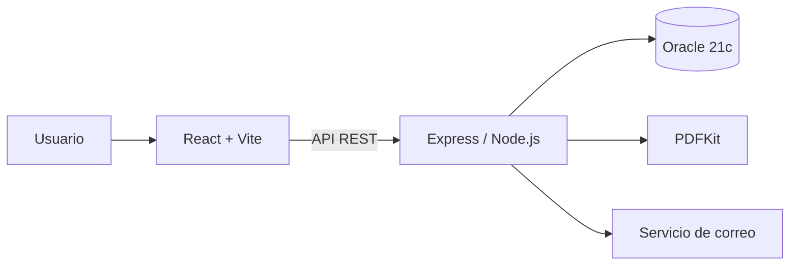

<div align="center">

# SABOTINO

### Sistema integral de gestión comercial y punto de venta

Plataforma web para administrar las operaciones de una panadería y pastelería, desde el abastecimiento hasta la venta y el cierre de caja.

    

</div>

## Descripción

SABOTINO reúne en una sola aplicación las operaciones de un negocio comercial. Separa la interfaz de usuario, la API y las reglas de persistencia, utilizando procedimientos almacenados de Oracle para operaciones de negocio. El proyecto está orientado a una instalación local y fue desarrollado en un contexto académico.

## Funcionalidades

| Módulo | Funcionalidad |
| --- | --- |
| Punto de venta | Catálogo, cesta, confirmación de ventas y pagos divididos |
| Caja | Apertura, arqueo y cierre de turnos |
| Inventario | Productos, insumos, ajustes y alertas de stock |
| Abastecimiento | Compras de varios artículos y gestión de proveedores |
| Usuarios | Acceso diferenciado para dueño y vendedor, horarios y sesiones |
| Reportes | Indicadores, consultas y exportación CSV/PDF |
| Comprobantes | Generación de PDF y envío por correo configurable |

## Arquitectura



| Capa | Tecnología |
| --- | --- |
| Interfaz | React, Vite, CSS |
| API | Node.js, Express |
| Persistencia | Oracle Database 21c, SQL y PL/SQL |
| Seguridad | Argon2id, sesiones Express, validación de roles |
| Documentos | PDFKit |
| Pruebas | Node.js test runner y conexiones simuladas |

## Estructura

```text
backend/
  src/config/       Configuración y conexión
  src/routes/       Endpoints de la API
  src/services/     Servicios de negocio
  test/             Pruebas automatizadas
frontend/
  src/              Componentes y estilos
  public/           Recursos visuales
  scripts/          Herramientas de verificación
docs/
  oracle/           Arquitectura de base de datos
```

## Instalación local

**Requisitos:** Git, Node.js compatible con las dependencias del proyecto, npm y una instancia Oracle 21c con el esquema SABOTINO previamente provisionado. El repositorio no garantiza por sí solo la creación completa del esquema.

```bash
git clone https://github.com/rodridarklau/base-de-datos.git
cd base-de-datos/backend
npm ci
```

Crear un archivo local `backend/.env` con la configuración propia. No subirlo al repositorio.

```dotenv
ORACLE_USER=
ORACLE_PASSWORD=
ORACLE_CONNECT_STRING=
SESSION_SECRET=
PORT=3000
```

El secreto de sesión debe tener al menos 32 caracteres y generarse de forma segura. El servicio de correo es opcional y requiere configuración adicional.

Iniciar la API:

```bash
node server.js
```

En otra terminal, desde la raíz del repositorio:

```bash
cd frontend
npm ci
npm run dev
```

Abrir la dirección local que indica Vite (habitualmente `http://localhost:5173`). El proxy de desarrollo conecta con la API local.

## Verificación

Desde `backend`:

```bash
node --test test/*.test.js
```

Desde `frontend`:

```bash
npm run lint
npm run build
```

## Estado y alcance

Proyecto en desarrollo local. Antes de un despliegue público es necesario revisar HTTPS, almacenamiento de sesiones, configuración de orígenes, dependencias y protección de datos. Las pruebas y la instalación dependen del entorno disponible.

## Créditos

Proyecto académico colaborativo. Los aportes individuales se reflejan en el historial del repositorio; la documentación no atribuye en exclusiva el trabajo grupal a una sola persona.
